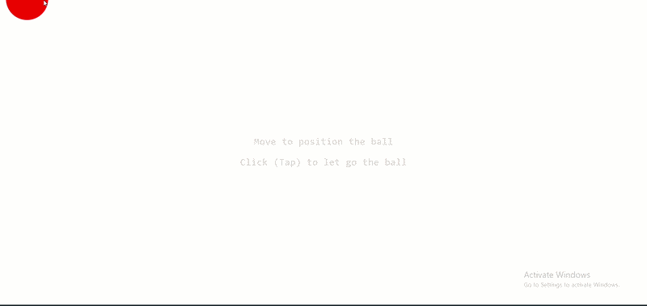

# 032 — Bouncing Ball Simulation

> **Phase 2 — Animations & Interactivity** | Experiment 032 of 100

---

## 🎯 What It Does

- Renders a red ball on a full-window page that follows the pointer with a soft glide instead of sticking to it, using an easing step on every frame (`x += (targetX - x) * 0.2`)
- Drops the ball on click or tap, and from that moment gravity takes over: every frame gravity changes the speed (`v += gravity`), and the speed changes the position (`y += v`)
- Detects the floor by checking the ball's bottom edge (`y + ballHeight`) against `window.innerHeight`, snaps the ball exactly onto the floor, and bounces it by multiplying the speed by a negative number (`v = bounce * v`, with `bounce = -0.8`)
- Brings the ball to rest once the bounce speed is small enough to be invisible (`Math.abs(v) <= 1`), sets the speed to `0`, waits 1.5 seconds, and then glides it back to the pointer's latest position
- Runs the whole thing as three modes — `aiming`, `falling`, and `resting` — stored in one `state` variable that the animation loop reads every frame
- Keeps the event listeners simple: `pointermove` only records where the pointer is, `click` only changes the state, and the loop is the only place that moves the ball (through a single `transform`)
- Works on touch screens: `touch-action: none` stops the page from scrolling while a finger positions the ball, and the instruction text has `pointer-events: none` so it never blocks a tap

---

## 💡 What I Learned

- **Gravity changes the speed, and the speed changes the position** — gravity never moves the ball directly. It adds a small push to `v` on every frame, and `v` moves `y`. Mass isn't needed at all, since a heavy ball and a light one fall the same way.
- **The bounce is a multiplier between -1 and 0** — the negative sign flips the direction, and the size decides how much energy is kept. `-1` would bounce forever with no loss, and `-0.8` keeps 80% of the speed on each bounce. This number (restitution) is the one to tweak until it feels right.
- **A variable should have one meaning** — I first used one `distance` variable for gravity, speed, and position, and nothing worked until each got its own: `gravity` (a constant), `v` (changes by gravity), and `y` (changes by `v`). Flipping the sign of `y` would teleport the ball, so only `v` flips.
- **`y` has to mean the same thing in every mode** — while aiming I stored the ball's center, and while falling I treated `y` as its top edge, so the ball would have sunk halfway into the floor. Storing the top edge everywhere and subtracting half the ball size when following the pointer fixed it.
- **The floor check has to ask where the ball is *now*** — measuring `getBoundingClientRect()` at the start of the frame describes the old position, so the ball got stuck on the floor. Checking `y + ballHeight` after `y` has moved gives the real answer.
- **Fix the position, then flip the speed** — the ball moves in jumps, so it usually lands slightly *inside* the floor. Setting `y = window.innerHeight - ballHeight` puts it back exactly on the floor before the speed is flipped.
- **The "jitter" is real physics, and the threshold has to clear it** — on the floor, gravity adds `+0.5` and the bounce multiplies by `-0.8`, and those two settle at about `-0.22` forever. The ball looks still, but the math keeps running. A threshold of `1` is safely above that number, and it still works if `gravity` is changed slightly.
- **A resting ball is stable once the speed is zeroed** — the next frame gives `0.5`, the bounce makes it `-0.4`, the threshold catches it, and `v` goes back to `0`. Tracing a few frames by hand was the quickest way to see that.
- **Events record, the loop moves** — a `state` variable isn't something that "stops" things. Events write it (`click` → `falling`, the floor check → `resting`, the timeout → `aiming`), and the loop reads it every frame and picks the matching branch.
- **Listeners belong outside the loop, and timers start once** — a listener inside `loop` would register 60 times a second, and a `setTimeout` checked every frame would schedule 60 timers a second. The timeout starts at the single moment the ball becomes resting.
- **Easing gives the following and the return for free** — moving a fraction of the distance to the target each frame makes the ball trail the pointer smoothly, and the same line makes it glide back after resting, because the ball is simply far from the target again.
- **Only one thing should write the `transform`** — two places writing it (the pointer handler and the loop) fight each other, and the loop always wins. One line at the end of `loop` runs every frame, in every state.
- **Known limitation: the physics is per frame, not per second** — on a 120Hz screen the ball would fall and bounce about twice as fast as on a 60Hz one. Using the time between frames would fix it, and that's an idea for a later experiment.

---

## 🚧 Challenges I Faced

- **The ball fell at a constant speed:** I had `speed = v * y` inside the loop, which mixed the speed with the ball's position, and `v` itself was never updated. Fixed by deleting the extra variable and writing `v += gravity` and `y += v` with `+=`, so the speed accumulates.
- **The bounce flipped the wrong thing:** I wanted to change the sign of both the speed and the position. Flipping `y` would move the ball to a random place on the screen. Fixed by flipping only `v`, and setting `y` to a fixed floor value instead.
- **The ball stuck to the floor instead of bouncing:** the floor check used a `rect` measured once at the top, so it never reflected the ball's real position. Fixed by checking `y + ballHeight` instead.
- **The ball never stopped moving:** the console showed `v` hovering around `-0.2222` forever. Fixed by working out where that number comes from and adding a threshold: when `Math.abs(v) <= 1`, `v` becomes `0`.
- **The ball was off-center:** the pointer handler and the loop were both writing the transform, and the loop overwrote the centering. Fixed by keeping one transform line in the loop and doing the centering in the target position (`pointerX - ballWidth / 2`).
- **The ball jumped to the pointer after resting:** the handler's guard only blocked the `falling` state, so moving the mouse during `resting` snapped the ball over instantly. Fixed by making `pointermove` only record the position, and letting the loop do all the moving.
- **The 2-second delay did nothing:** my `resting` block switched the state to `aiming` right away, so the timeout was irrelevant. Fixed by starting the `setTimeout` once, inside the floor check where the ball becomes resting, and removing the `resting` block.
- **I put the physics in the wrong place:** an early draft had the `addEventListener` calls inside `loop` and the falling code inside the click handler. Fixed by moving the listeners outside and keeping the click to a single line, `state = 'falling'`.

---

## 🔗 Live Demo

[View Live](https://reiwebdeveloper.github.io/rei_creative_coding_lab/02_Animation_&_Interactivity/032_bouncing_ball/)

---

## 📸 Preview

---

## ⏱️ Time Taken

~16h

---

[← Back to Main README](../../README.md)