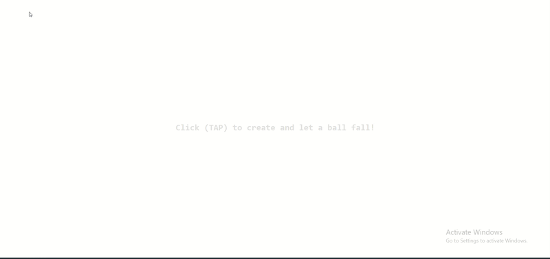

# 033 — Multiple Ball System

> **Phase 2 — Animations & Interactivity** | Experiment 033 of 100

---

## 🎯 What It Does

- Creates a new ball every time the user clicks or taps, centered exactly under the pointer, and lets it fall immediately (up to 10 balls on screen at once)
- Gives every ball its own random size (50–100px), color, gravity (`0.2`–`0.9`), and bounce (`-0.5` to `-0.85`), so no two balls fall or bounce the same way
- Stores each ball as an object (`width`, `height`, `xPos`, `yPos`, `v`, `gravity`, `bounce`, `color`, `state`, `el`) and keeps all of them in one array, `ballArray`
- Runs a single animation loop that visits every ball in the array each frame and calls `updateBall(ball)`, which applies gravity (`v += gravity`), moves the ball (`yPos += v`), checks the floor, and writes the `transform`
- Detects the floor with the ball's bottom edge (`yPos + height`), snaps the ball exactly onto it, and bounces it with `v = bounce * v`
- Brings a ball to rest when `Math.abs(v) <= 1`, then removes its div from the DOM and the ball from the array 3 seconds later, which frees a slot for a new one
- Works on touch screens: `touch-action: none` stops page scrolling, and the instruction text has `pointer-events: none` so it never blocks a tap

---

## 💡 What I Learned

- **When one thing becomes many, the question is what belongs to each one** — in experiment 032 the ball's `y`, `v`, and `state` were standalone variables. With many balls they can't be shared, so each ball became an object that carries its own state, while the rules of the world (like the floor) stay shared.
- **Creating a ball and animating a ball are two different moments** — the div, its size, its color, and `ball.el = newBall` run once, in the click listener. Gravity, movement, the floor check, and the `transform` run every frame, in `updateBall`. A good test for where a line goes is how many times it should run for one ball.
- **The loop takes no arguments, it walks the array** — `requestAnimationFrame` calls `loop` with a timestamp, so passing it a ball doesn't work. `loop()` goes through `ballArray`, and `updateBall(ball)` handles one frame for one ball.
- **One object can have two names** — the object is `ballObj` in the click listener and `ball` inside `updateBall`, but it's the same object. A name only exists inside the function that declares it.
- **The object needs a handle to its div** — changing `ball.yPos` only changes a number. Storing the div on the object (`ballObj.el = newBall`) is what lets the loop move the right element on screen.
- **Start the loop once** — calling `loop()` inside the click listener would start another loop on every click. One `loop()` call at the bottom of the file is enough, and an empty array just means it does nothing.
- **Build the object fully before using it** — I set `xPos = e.clientX - ballObj.width / 2` before `createBallObj` had given the ball its width, so the centering used `0`. Calling `createBallObj` first fixed it with no new code.
- **A position has to mean the same thing everywhere** — `xPos` and `yPos` are the top-left corner, so the floor check (`yPos + height`) and the `transform` agree. Mixing a center-based position with that floor check would sink the ball into the floor.
- **A random range needs a min and a max** — a raw `Math.random()` can give a gravity near `0` or a bounce near `0`, which looks broken. The pattern `min + Math.random() * (max - min)` gives balls that all feel good but different, and for bounce it's easiest to build a positive range and negate it at the end.
- **Setting `state = 'resting'` stops the falling branch** — the removal timeout is scheduled once, because after the state changes the `falling` block never runs again for that ball.
- **Removing from the array is safe inside `setTimeout`** — the removal runs outside the `for...of` loop, so it can't skip a ball in the middle of a pass.
- **Known limitation: the physics is per frame, not per second** — on a 120Hz screen the balls fall about twice as fast as on a 60Hz one. Using the time between frames would fix it, and that's an idea for a later experiment.

---

## 🚧 Challenges I Faced

- **The ball was created inside the loop:** I wrote `const ball = {...}` at the top of `loop()`, so every frame made a brand-new ball in the `aiming` state, the `falling` branch never ran, and nothing in the array was ever updated. Fixed by creating the ball once in the click listener and letting the loop only visit existing balls.
- **Every click started another loop:** `loop()` was called inside the click listener, so three clicks meant three loops running at once. Fixed by calling `loop()` once at the bottom of the file.
- **The div was created in `updateBall`:** this made about 60 divs per second for one ball. Fixed by moving all the div creation into the click listener and keeping only the `transform` line in `updateBall`.
- **The ball object and the div weren't connected:** I created `ballObj` and `newBall` but nothing linked them, so changing the object didn't change the screen. Fixed with `ballObj.el = newBall`, after realizing `ball` doesn't exist in the click listener but the same object does, under the name `ballObj`.
- **Bare variables from experiment 032:** `v` and `state` in the resting check were fine as standalone variables before, but now they belong to the ball. Fixed by writing `ball.v` and `ball.state`, and `ball.yPos` instead of `ball.y`.
- **The ball wasn't centered on the click:** the centering ran before `createBallObj`, so `width` was still `0`. Fixed by reordering the lines.
- **The balls jumped to the top-left corner:** the click position was only used for the first `transform` and never stored on the object, so the next frame overwrote it with `0, 0`. Fixed by storing the click position in `xPos` and `yPos`.
- **Some balls looked dead and others never stopped:** `Math.random() * -1` can land anywhere between no bounce and a perfect bounce. Fixed with a controlled range for both bounce and gravity.
- **Leftovers from the old idea:** the `aiming` state, `pointerX/Y`, and `targetX/Y` from experiment 032 had no job here, because the click itself is the aim. Fixed by deleting them, and updating the on-screen text to match.

---

## 🔗 Live Demo

[View Live](https://reiwebdeveloper.github.io/rei_creative_coding_lab/02_Animation_&_Interactivity/033_multiple_ball_system/)

---

## 📸 Preview

---

## ⏱️ Time Taken

~5h

---

[← Back to Main README](../../README.md)